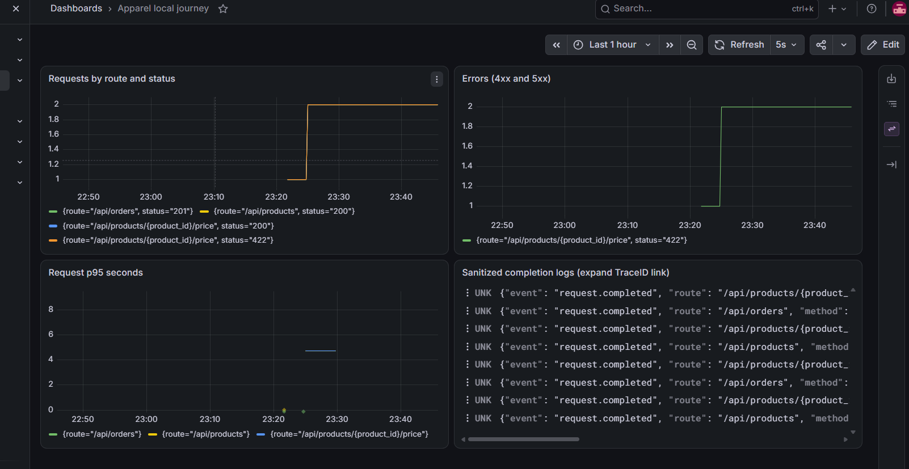
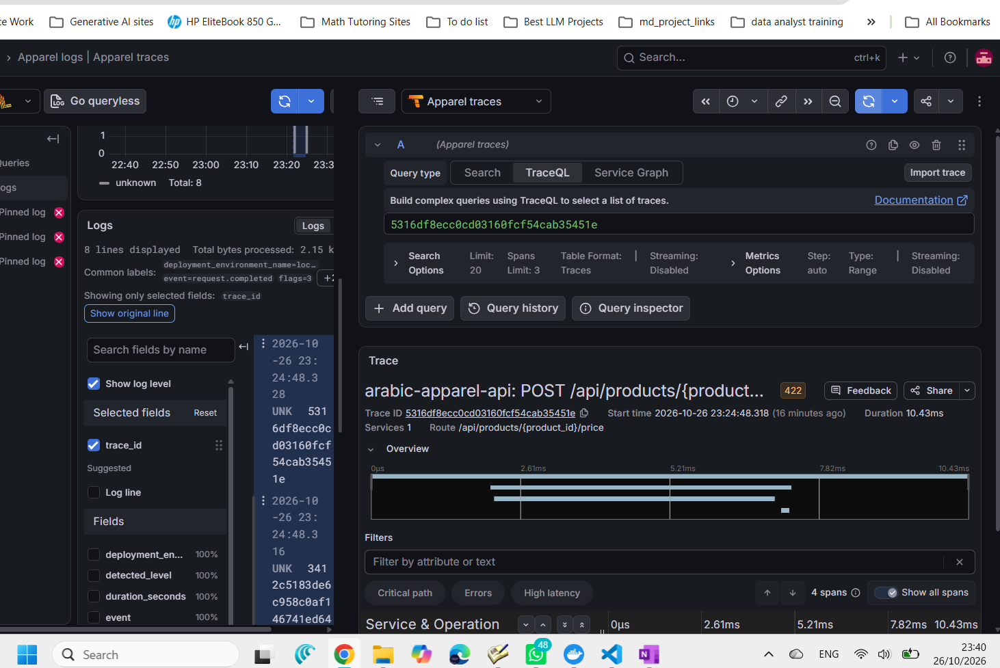

# Local observability (Issue #6, Phase 1)

This optional stack is local only. Vercel/Grafana Cloud exports are not configured.
Normal Docker development/production configurations are unchanged; telemetry is
off unless LOCAL_OBSERVABILITY=1. No migration or catalogue change is required.

## Start and demonstrate (PowerShell, repository root)

Requires Docker Desktop/Compose and sufficient free memory/disk for the pinned
LGTM demo image (several GB). Ports 3000 and 18080 must be free. This standalone
project uses an isolated PostgreSQL tmpfs database, never existing volumes or Neon.
Do not merge this file with compose.yml or compose.production.yml.
If another local stack already occupies these ports, leave it running and set
`$env:LOCAL_GRAFANA_PORT='3001'` and `$env:LOCAL_FRONTEND_PORT='18081'` before the
commands below; use those alternate ports in browser URLs. These variables affect
only the local Compose stack, not Vercel. Defaults remain 3000 and 18080.

```powershell
docker compose -p apparel-observability -f compose.observability.yml up -d --build frontend lgtm
docker compose -p apparel-observability -f compose.observability.yml --profile demo run --rm demo
docker compose -p apparel-observability -f compose.observability.yml --profile demo run --build --rm browser
```

The script generates catalogue, valid Arabic pricing, one synthetic order and a
422 validation error. It polls metrics/log/trace storage through Grafana's
datasource proxies and verifies the order log's trace ID retrieves its trace.
It prints only a trace ID and pass/fail, never request data. Each run creates one
additional synthetic order in this disposable database. It does not test Vercel.
The optional browser command checks actual Chromium renders the four dashboard
panels; it does not assert exemplar click-through or Explore trace navigation.

Open the local app at http://localhost:18080 and Grafana at http://localhost:3000.
Open dashboard http://localhost:3000/d/apparel-local (last 15 minutes). LGTM's
built-in local login is admin/admin if prompted; never expose this demo stack
publicly. OTLP/storage ports are not published to the host. LGTM contains its own
default data sources; the provisioned Apparel sources provide explicit links.

## Inspect correlation

1. Dashboard: requests grouped by route/status, errors and p95 latency. Generate
   repeated traffic over a few minutes for rate/p95 panels to become meaningful.
2. Explore > Apparel logs: `{service_name="arabic-apparel-api"} | json`.
   Select an order completion (`route=/api/orders`, `status=201`). Expand its
   TraceID derived field to navigate to Apparel traces; alternatively paste the
   printed trace ID into Explore > Apparel traces > Trace ID.
3. Verify the trace contains request, order.create, product.lookup, price.lookup,
   pricing.validate and pricing.calculate spans, and that the completion log's
   span ID matches the request span. Traces are per HTTP request, not a fabricated
   shared ID across separate catalogue/price/order calls.
4. Metrics: `apparel_requests_total`, `apparel_errors_total`, and
   `apparel_request_duration_seconds_bucket`. Use
   `sum by (route,status) (apparel_requests_total)` and
   `histogram_quantile(0.95, sum by (le,route) (rate(apparel_request_duration_seconds_bucket[5m])))`.
5. Histogram targets enable exemplars and the metric source links trace_id to
   Tempo. Configuration alone is NOT evidence that exemplars survived SDK,
   collector, storage and Grafana. Actual exemplar/UI results must be recorded
   separately in TASK_TRACKER.md and Issue #6. Do not claim them from counters.

## Privacy and failure isolation

Manual OpenTelemetry SDK spans avoid HTTP/SQL automatic attribute capture.
Only fixed operation names, allowlisted route templates, bounded HTTP methods,
status codes, timings and generated trace/span IDs are emitted. No bodies,
names, contacts, Arabic text, query strings, headers, cookies, credentials,
SQL statements/parameters, order IDs or exception messages are recorded.
Unmatched paths are never copied to telemetry. Request counts include 4xx/5xx;
errors count status >=400, rather than treating validation failures as success.

Request completion logs are JSON on stdout and OTLP LogRecords with matching
trace/span IDs. Trace IDs are not metric labels. All local request traces are
sampled; histogram exemplars depend on the sampled active span. Resource fields
are explicit and do not automatically collect hostname/environment contents.
No incoming baggage or arbitrary trace headers are captured/propagated.

OTLP export uses bounded background queues and one-second HTTP exporter timeouts.
Collector failures may drop telemetry but must not interrupt customer requests;
no order retry is introduced. SDK exporter diagnostics are suppressed to avoid
logging endpoint/credential-bearing exception text. App startup also tolerates
optional telemetry configuration failure. This is a local demo reliability
tradeoff, not guaranteed telemetry delivery. Vercel needs separate lifecycle,
flush, concurrency and quota validation before any production enablement.

## Automated checks and grading evidence

Backend pytest includes real SDK in-memory logs/spans/metrics, correlation,
successful/error counts, sensitive sentinels, committed synthetic-order behavior
under telemetry failure and sanitized 500 paths. The existing CI backend pytest
command discovers these tests. No CI workflows changed.
The separate demo script checks actual LGTM storage, not only SDK mocks.

Record tested commit/diff, versions, commands and sanitized results. Capture a
dashboard screenshot, matching log/trace screenshot and (if actually present)
metric-exemplar-to-trace navigation. Use only synthetic local data, crop account
details/tokens and record the selected time window/queries. A reviewer should
repeat setup and privacy checks independently. No human review is implied by
implementer testing. Local evidence must not be described as production monitoring.

### Observed implementer validation

On 2026-10-26, the isolated review stack passed the storage demo: all three
signals were queryable, the order log retrieved its trace, and four stored
metric exemplars were returned; one exemplar resolved to a retained trace.
Chromium rendered all four provisioned dashboard panels. SDK correlation,
privacy, exemplars, sanitized 500 and exporter-failure tests passed; the full
backend suite with isolated migrated PostgreSQL passed 46 tests, frontend eight
tests and production build passed. These are local results, not production
monitoring or an independent human review. The owner subsequently supplied the
screenshots below and reports manually following a log TraceID to a four-span
trace. Manual metric-exemplar click-through is not claimed. See the tracker and
Issue #6 for the handoff and outstanding independent review.
With the local collector stopped, an additional synthetic order returned HTTP
201 and a separate database session confirmed its persisted row. The collector
was restarted afterward; no shared/local developer or hosted database was used.

### Owner-provided UI evidence

Both screenshots are stored in the existing observability folder. They show
local monitoring, not Vercel or Grafana Cloud. Visual inspection found no customer
names, contact details, personalization, credentials or tokens in the images.
Owner verification is not an independent reviewer sign-off.





The correlation image shows trace `5316df8ecc0cd03160fcf54cab35451e` for a pricing
validation response (HTTP 422), with matching log/trace IDs and four spans. This
is a valid error-path trace; an order trace can contain more spans. Follow a log's
TraceID derived-field link, or paste the exact ID into the Tempo Trace ID view.
Trace IDs from an earlier disposable run will not exist in a newly started stack:
generate fresh traffic and use its new IDs when reproducing the evidence.

Stop this disposable stack without touching existing volumes:

```powershell
docker compose -p apparel-observability -f compose.observability.yml down
```

Its database is intentionally lost when the container is removed. This command
does not delete any existing named PostgreSQL volume. Never use down -v here.

References: [LGTM demo stack](https://github.com/grafana/docker-otel-lgtm),
[Python SDK](https://opentelemetry.io/docs/languages/python/instrumentation/),
[Grafana exemplars](https://grafana.com/docs/grafana/latest/fundamentals/exemplars/).
