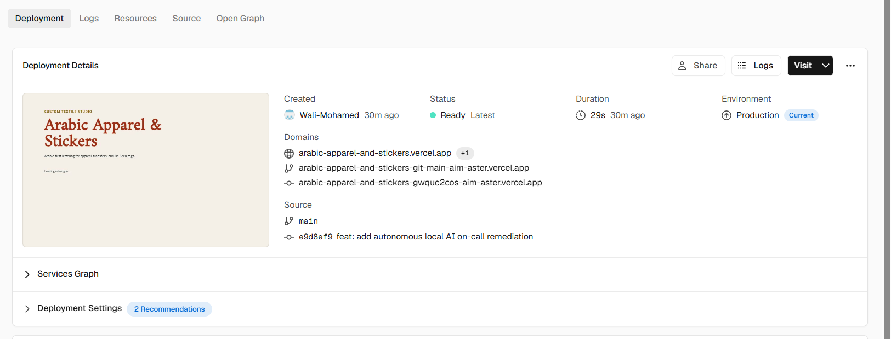

# Capstone submission evidence

- Application: [Arabic Apparel and Stickers](https://arabic-apparel-and-stickers.vercel.app/)
- Repository: [Wali-Mohamed/arabic-apparel-and-stickers](https://github.com/Wali-Mohamed/arabic-apparel-and-stickers)
- Rubric: [AI Dev Tools Zoomcamp 2026 final project](https://github.com/DataTalksClub/ai-dev-tools-zoomcamp/blob/main/project/README.md)
- Public backlog: [GitHub Issues](https://github.com/Wali-Mohamed/arabic-apparel-and-stickers/issues)
- Implementation evidence baseline: [e9d8ef9](https://github.com/Wali-Mohamed/arabic-apparel-and-stickers/commit/e9d8ef914c056bf2da6754f78bdea26dda8edcad)
- Matching [CI run: all six jobs passed](https://github.com/Wali-Mohamed/arabic-apparel-and-stickers/actions/runs/40546052593).

React/Vite and FastAPI are publicly deployed in one Vercel Services (beta)
project, with same-origin API routes and SSL-connected Neon PostgreSQL. This is
a non-commercial demo: no payments, checkout, authentication or fulfillment.
Use synthetic details only if deliberately submitting an order; orders persist.
Grafana/LGTM, pricing-failure alerting and Ollama on-call remediation are **local
demonstrations only**, not hosted production services.

## Estimated grading

Current estimate: **22/24 conservative; 23/24 if the Vercel automatic CD evidence
is accepted**. These are estimates, not awarded marks. No 24/24, independent
human review or completed peer reviews are claimed. The following totals use the
rubric's exact maximum marks; open issue acceptance criteria can be stricter.

| Criterion | Maximum | Estimate | Implemented evidence and limitations |
| --- | ---: | ---: | --- |
| Problem Description | 2 | 2 | [README](../README.md) describes personalization, pricing, order requests and exclusions. |
| Product Specification | 2 | 2 | [Specification](../spec.md), [task tracker](TASK_TRACKER.md), public issue acceptance criteria and [actual agent tracker review](https://github.com/Wali-Mohamed/arabic-apparel-and-stickers/issues/1#issuecomment-6421542642). |
| Agent Team Specification | 2 | 2 | [Roles and collaboration process](AI_AGENT_WORKFLOW.md). Team execution is proposed; a single local responder has actually run. Credit is for the written specification. |
| Context Management | 2 | 2 | [AGENTS.md](../AGENTS.md) directs agents to modular specification, architecture, workflow and tracker documents. |
| Application | 2 | 2 | [Public demo](https://arabic-apparel-and-stickers.vercel.app/), [architecture](ARCHITECTURE.md), [hosted quote/order evidence](https://github.com/Wali-Mohamed/arabic-apparel-and-stickers/issues/4#issuecomment-6429118340), and browser/database persistence checks. |
| Testing | 2 | 2 | [CI workflow](../.github/workflows/ci.yml), [isolated test stack](../compose.ci.yml), [PostgreSQL test](../backend/tests/integration/test_postgres.py). Baseline CI: 92 backend tests + one PostgreSQL integration test, eight frontend tests, two browser tests passed. Backend unit/integration run together; frontend/browser commands remain separate. |
| Containerization | 2 | 2 | [Development Compose](../compose.yml), [production Compose](../compose.production.yml), [production smoke script](../scripts/test-production.sh). Migration, browser journey and separate-session/restart persistence assertions passed in CI. |
| Deployment | 2 | 2 | Public Vercel/FastAPI/Neon demo; production screenshot below links main/e9d8ef9 to the live domain at capture time. Later independent hosted order retrieval and rollback drill remain unverified. |
| CI/CD | 3 | 1 or 2 | PR/main CI passes. Vercel bot reports deployment success; automatic Git triggering is strongly supported but inferred. GitHub development/production delivery jobs remain held, so no staged dev/manual-production demonstration. |
| Observability | 2 | 2 | [Local telemetry runbook](OBSERVABILITY.md), Grafana screenshots below, sanitized logs/traces and stored metrics/exemplars. No Vercel/Grafana Cloud monitoring. |
| Alerting on User Impact | 1 | 1 | [Rule](../observability/alerting.yaml), [runbook](ALERTING.md), [Issue #7 lifecycle evidence](https://github.com/Wali-Mohamed/arabic-apparel-and-stickers/issues/7#issuecomment-6443498336). Real pricing 503s, firing/resolved notification and recovery verified locally. |
| On-Call Agent | 2 | 2 | [Worker](../backend/app/oncall.py), [runbook](ONCALL.md), successful and failed real-model transcripts below. Agent independently removed the controlled fault; no driver cleanup counted as success. |
| Total | 24 | 22 or 23 | Independent assessment remains outstanding. |

## Vercel deployment evidence: facts versus inference



The supplied screenshot was visually reviewed. It shows **Ready / Latest**,
**Production / Current**, Git source **main**, commit **e9d8ef9**, and domain
`arabic-apparel-and-stickers.vercel.app`. No credentials or customer information
were visible. It is owner-provided evidence, not an independent provider audit,
and records the state at capture time rather than a permanent alias guarantee.

- Full source SHA: `e9d8ef914c056bf2da6754f78bdea26dda8edcad`.
- [Vercel deployment record](https://vercel.com/aim-aster/arabic-apparel-and-stickers/AaevsyrhBfRpfh66i2rtPVomfkPj).
- [GitHub Vercel bot statuses](https://api.github.com/repos/Wali-Mohamed/arabic-apparel-and-stickers/commits/e9d8ef914c056bf2da6754f78bdea26dda8edcad/statuses): Pending at 2026-10-27 16:58:03 UTC; Success at 16:58:32 UTC.
- [Push CI](https://github.com/Wali-Mohamed/arabic-apparel-and-stickers/actions/runs/40546052593) began at 16:58:03 UTC and completed successfully at 16:59:23 UTC. Backend, PostgreSQL integration, frontend, both Docker builds and production smoke all passed.

Those timestamps and the Git source strongly support deployment following the
push through Vercel's Git integration. They do **not** independently prove the
trigger event or rule out manual intervention. The screenshot's Created account
label alone proves neither a manual click nor automatic triggering. Read-only
provider API access returned 403 during investigation. No provider trigger/audit
record was retrieved. The public frontend/health/database-health/catalogue GETs
returned 200 and eight products during the grading audit; no new order was made.

Vercel completed before all CI jobs finished, so no CI-gated Vercel release is
claimed. [GitHub development deployment](https://github.com/Wali-Mohamed/arabic-apparel-and-stickers/actions/runs/40546268002)
was skipped under its explicit hold; the manual production job is also held.
These jobs are separate from Vercel's integration. See [CI/CD and rollback](CI_CD.md).
The rubric's additional staged-delivery point and a hosted rollback drill remain
undemonstrated. No new deployment is required merely to document existing facts.

## Reviewer setup and tests

Use Git and Docker Desktop with Linux containers and Compose v2. Clone the repo
and run the following from its root in PowerShell. Preserve any existing .env:

```powershell
if (-not (Test-Path .env)) { Copy-Item .env.example .env }
docker compose up --build
```

Open http://localhost:5173 (API http://localhost:8000). Follow the
[README walkthrough](../README.md#reviewer-walkthrough) for catalogue, fixed Be
Seen designs, Arabic personalization, server pricing and optional synthetic order
submission. Local development keeps Vite hot reload; the standalone production
image serves built static files through Nginx. Vite's development server is not
claimed production-ready.

Use a unique disposable project for real PostgreSQL integration; do not point
tests at Neon or an existing local database:

```powershell
$reviewProject='apparel-review-'+[guid]::NewGuid().ToString('N').Substring(0,10)
# One command builds, migrates and runs backend unit + PostgreSQL integration tests:
docker compose -p $reviewProject -f compose.ci.yml run --build --rm backend
# Separate frontend tests and production build with the committed lockfile:
docker compose -p $reviewProject -f compose.ci.yml run --build --rm --no-deps frontend
docker compose -p $reviewProject -f compose.ci.yml down
```

The test database is tmpfs and has no host port or existing volume. Do not add
production env files. A unified command for all backend/frontend/browser suites
is not provided. For isolated production images and real browser/persistence
checks, run `bash scripts/test-production.sh` on Linux or a suitably configured
Git Bash/WSL Docker environment; this is the same script used by CI. See the
[production runbook](PRODUCTION_DEPLOYMENT.md). Stop normal development with
`docker compose down`; never delete database volumes for grading.

## Reproduce local monitoring, alerting and AI response

Run these demonstrations separately to limit memory use. Leave existing services
and databases untouched; choose free loopback ports if necessary.

```powershell
# Separate observability stack, default Grafana 3000 / app 18080:
docker compose -p apparel-observability -f compose.observability.yml up -d --build frontend lgtm
docker compose -p apparel-observability -f compose.observability.yml --profile demo run --rm demo
docker compose -p apparel-observability -f compose.observability.yml --profile demo run --build --rm browser
docker compose -p apparel-observability -f compose.observability.yml down

# Automatic local alert firing, notification and recovery verification:
.\scripts\test-alerting.ps1

# Real local model: authenticated alert -> diagnostics -> guarded removal -> recovery:
.\scripts\test-oncall.ps1
```

Inspect Grafana before stopping its stack. The [observability runbook](OBSERVABILITY.md)
explains free-port overrides, dashboard `/d/apparel-local`, log TraceID links and
fresh traffic. Alerting defaults to Grafana 3010/app 18100; on-call defaults to
3020/18200. Use each script's `-KeepStack` option for later inspection; fallback
cleanup still runs after its recorded outcome. Full scripts can take minutes.


These are owner-provided local screenshots. The correlation image is a pricing
422 path, not an order trace. Stored exemplar retrieval was verified; manual
exemplar click-through is not claimed. Disposable stacks require new traffic
and trace IDs after recreation.

The [AI responder runbook](ONCALL.md) documents Ollama 0.6.8 and Qwen2.5 0.5B
with pinned image/model digests. Tested allocation: about 8 GB Docker RAM and
four CPUs, no GPU or paid API. Allow several GB of disk for downloads. The worker
has fixed tools, one allowed marker removal, authentication, evidence gates and
an internal runtime network without cloud credentials or Docker socket. Never
publish `.oncall-local/`: it contains generated secrets beside sanitized output.

- [Successful real-model transcript](../observability/oncall-transcript.json): firing activated the worker at 16:45:10 UTC; actual metrics/logs/traces and 503 probe; model chose remediation; agent removed marker at 16:45:22; HTTP 200 probes followed; matching resolved receipt at 16:47:30 and healthy Recovered at 16:47:31. Seven tools, one remediation.
- [Failed first attempt](../observability/oncall-failed-attempt.json): actual model escalated despite supporting evidence; no agent removal. Failure was recorded before fallback cleanup. The clearer typed prompt then passed with the same model and gates.
- [Published Issue #8 verification](https://github.com/Wali-Mohamed/arabic-apparel-and-stickers/issues/8#issuecomment-6448216633).

Python gathers fixed diagnostic evidence; the real LLM decides between allowed
remediation and escalation. It does not choose arbitrary queries or execute
commands. Neither cleanup nor mocked decisions count as real-model success.

## Outstanding submission obligations and limits

- Independent reviewer validation is not recorded. Existing owner checks and
  implementing-agent reviews are not independent human approval. Manual alert
  and on-call Grafana lifecycle screenshots remain outstanding.
- The course requires **three peer reviews of other participants' projects**.
  Completion is not evidenced here; a numerical score alone does not satisfy
  that obligation. Check current deadlines/workflow on the course platform.
- Explicit Vercel automatic-trigger audit evidence remains missing. Separate
  dev delivery, manual production delivery and hosted rollback/restore are not
  demonstrated; no 24/24 claim is justified.
- Hosted order 201/commit evidence is recorded, but no later independent hosted
  SQL retrieval or restart durability check was performed. Do not expose order
  history or credentials solely for grading. No new hosted order is needed for
  this documentation publication.
- Local telemetry/alerts/agent do not monitor or remediate production. Missing
  or frozen telemetry needs additional availability coverage; the agent fixes
  only the injected marker fault. The first model failure limits reliability claims.
- Real LGTM/model demonstrations are local scripts, not hosted CI end-to-end
  jobs. Known AnyIO/Actions runtime deprecation warnings remain non-failing.
- Issues remain open where review or other acceptance criteria remain. Consult
  [TASK_TRACKER.md](TASK_TRACKER.md) and the public backlog for historical results;
  this guide supersedes stale preparation-only summaries, not execution records.
